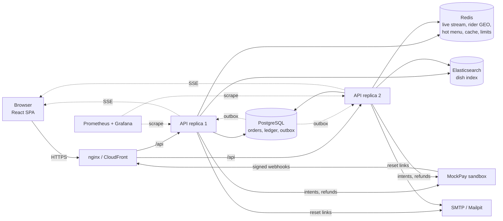

# Wokflow — Chinese food delivery platform

> **2026 rebuild.** I first built this project during a training program; that code was lost, so this
> repository is a from-scratch rebuild made in November 2026. Commit dates are real. Every performance
> number below was measured in this repository and is reproducible with the scripts in `loadtest/`
> (details and caveats in [docs/performance.md](docs/performance.md)).

Wokflow connects customers with regional Chinese restaurants (Sichuan, Cantonese, Lanzhou, Shanghai, Hunan,
Taiwanese…) in the San Gabriel Valley. Customers search in English, Chinese characters or pinyin, order and
pay, and watch the order move from wok to door live; kitchens run a live order board, manage their menu and
stock, and see their earnings in a double-entry ledger; riders claim and deliver jobs.

| Customer: live order tracking | Kitchen: live order board |
|---|---|
|  |  |
| **Menu with dish photos** | **Kitchen: menu editor** |
|  |  |
| **Search: `mpdf` → 麻婆豆腐 (pinyin initials)** | **中文界面 (mobile)** |
|  |  |

## What it does

**For customers** — search in English, Chinese characters or pinyin; see only kitchens that deliver to the
pin you chose, with the delivery fee and time for that distance; order and pay; watch the order and the
rider's position move live; review it afterwards. **For kitchens** — apply as a partner, get approved, edit
the menu (categories, dishes, photos, daily stock), run a live order board, answer reviews, and see
earnings in a double-entry ledger. **For riders** — go online, receive the nearest offer with a 30-second
timer (or take jobs from the board), and deliver. **For admins** — approve kitchens and riders, suspend
them, and read the audit log.

How the hard parts work:

- **Orders at peak without deadlocks or stale status**: every order change is a single-row compare-and-set
  (`UPDATE … WHERE status = ANY(…) AND version = ?`); limited stock is reserved in single autocommit
  statements in ascending dish order; placements go through a bulkhead and answer overload with
  `503 Retry-After`. Retries are safe: placements carry an Idempotency-Key, status changes an `If-Match`
  version, and a retry of a change that already happened returns the current order instead of a conflict.
- **Payments**: a bundled sandbox provider (`mockpay/`) with intents, a hosted checkout page, HMAC-signed
  and timestamped webhooks delivered at least once, and refunds; webhooks are processed exactly once. A
  Stripe Checkout adapter (`PAYMENT_PROVIDER=stripe`, test keys only) is checked against stripe-mock.
- **PostgreSQL ACID ledger**: double-entry, append-only (triggers refuse UPDATE/DELETE), every entry sums to
  zero (deferred constraint trigger), one entry per business event; payouts cannot overdraw, even
  concurrently.
- **Live updates**: a transactional outbox feeds one bounded Redis Stream; every API replica tails it and
  pushes to browsers over SSE. A reconnecting browser sends `Last-Event-ID` and gets exactly what it missed
  (or a fresh snapshot if it was away too long); every event carries the order version, so a screen never
  moves backwards.
- **Dispatch and geography**: rider positions in a Redis GEO set; offers go to the nearest online rider,
  expire after 30 s and move on. Delivery areas are geo-shapes in Elasticsearch (with a haversine fallback in
  Postgres); fee = base + distance beyond 2 km.
- **Search**: English with typos, CJK bigrams, pinyin three ways (`mapo doufu`, `mapodoufu`, initials
  `mpdf`), facets, popularity and a Bayesian rating boost; rebuilt by alias swap when out of step. If
  Elasticsearch is down or slow, search answers from Postgres instead of failing.
- **Redis hot menu**: hourly sorted sets of paid dish counts summed with `ZUNIONSTORE`, exactly-once
  counting in a Lua script, self-rebuilding from the ledger.
- **Auth**: ES256 access tokens verified by signature (JWKS at `/.well-known/jwks.json`, rotation with
  retired keys still accepted), rotating httpOnly refresh cookies with reuse detection, password reset by
  e-mail with single-use 30-minute links that end every session.
- **Images**: uploads are sniffed by magic bytes, size-checked before decoding, re-encoded without metadata
  into three sizes, stored content-addressed (local disk or S3) and served with immutable caching.
- **Operating it**: Prometheus + Grafana profile with a [dashboard](docs/screenshots/grafana-dashboard.png) and alert rules; fault-injection tests that
  freeze Postgres, Redis and Elasticsearch; runbooks for key rotation and failures in
  [docs/operations.md](docs/operations.md).
- **Web app** (React 19, TypeScript): English/中文 with a completeness test, WCAG 2.1 AA audited with axe in
  CI, strict CSP, lazy-loaded pages.

## Measured (2-vCPU VM, everything incl. the load generator on one machine)

| What | Result |
|---|---|
| 600 orders placed at the same instant, each then paid, accepted, readied, claimed, picked up, delivered | all 600 handled in every run (cold + 3 warm): 400 delivered + 200 correctly refused as sold out (300 people wanted a dish with 100 baskets); **0 deadlocks, 0 oversold, 0 stale reads** in 2,000 read-after-write checks per run, ledger balanced |
| Steady rush, 60 s | 10 orders/s: place p50 18 ms / p95 41 ms; 25 orders/s: p50 28 ms / p95 492 ms; 60 orders/s: overloaded (p50 3 s) and shedding with 503, 0 errors |
| Payment confirmed → order PAID (server clocks) | p50 35 ms / p95 67 ms at 15 orders/s |
| Live status over SSE (commit → browser) | 5 streams, steps 0.5 s apart: p50 25–45 ms; 200 orders driven at once: p50 0.8–1.3 s; every event in order, 0 lost |
| A dependency frozen mid-test | Elasticsearch: search answers from Postgres after 1.5 s, then ~15 ms; Redis: first page 2.1 s, then normal; Postgres: 503 in 6–10 s and back without a restart |
| Hot menu, 293,583 paid orders in the window | Redis 0.35 ms (0.06 ms cached) vs SQL aggregation 246 ms; identical top 6 |
| Search, 100,000 dishes, 20 clients | Elasticsearch p50 113–168 ms vs Postgres fallback 2.8 s; top-1 accuracy on 16 typo/pinyin/Chinese queries 15/16 vs 10/16 |
| Authenticated requests with the verified-token cache | 556 → 1,088 req/s on the same box |
| Lighthouse (mobile, median of 3) | 95–99 performance and 100 accessibility / best practices / SEO on home, search, sign-in, cart; 85–86 on restaurant pages (the cover photo is the LCP element) |

At 64 demo dishes the Postgres fallback is actually faster than Elasticsearch (20 ms vs ~185 ms); the
point of Elasticsearch here is relevance and facets at catalog scale. Conversion impact (the original
resume line claimed "+18%") cannot be measured without real users and is not claimed. Details, every run
and the caveats: [docs/performance.md](docs/performance.md).

## Architecture



| Module | |
|---|---|
| `api/` | Spring Boot 4.2 (Java 21, virtual threads), JDBC + Flyway, Spring Security resource server, Elasticsearch Java client 9, Lettuce |
| `mockpay/` | Sandbox payment provider: intents, hosted checkout, refunds, webhook delivery with leases and backoff |
| `web/` | React 19 + React Router 8 + Vite 8, TypeScript, Vitest, Playwright + axe |
| `loadtest/` | k6 peak-hour test, database invariant checks, SSE latency check, search and hot-menu benchmarks |
| `observability/` | Prometheus scrape config and alert rules, Grafana dashboard (generated by `build-dashboard.py`) |
| `infra/` | Terraform for AWS (CloudFront, ECS Fargate, RDS, ElastiCache, WAF) + Elastic Cloud — validated and scanned, not applied ([infra/README.md](infra/README.md)) |

Key flows are described in [docs/engineering-notes.md](docs/engineering-notes.md), together with the bugs
found while building and measuring it.

## Run it

Requirements: Docker with Compose v2.

```bash
docker compose up -d --build --wait     # first build takes a few minutes
open http://localhost:8000
```

Demo accounts (password `wokflow-demo`): `customer@example.com`, `merchant@example.com` (Lucky Star
Dumplings, Midnight Congee, Chengdu Night Market), `partners@example.com` (the other kitchens),
`rider@example.com`, `rider2@example.com`, `admin@example.com`. Midnight Congee and Lucky Star Dumplings are
open 24 hours, so there is always somewhere to order from; the others keep real hours in their own time zone.
Payment happens on the MockPay page (http://localhost:8090): **Pay** or **Decline** — no card details.
Password-reset mail is caught by Mailpit at http://localhost:8025. Monitoring is optional:
`docker compose --profile observability up -d`, then Grafana at http://localhost:3000.

Data lives in Docker volumes and survives `docker compose restart` / `down`; `docker compose down -v` resets.

### Development mode

```bash
docker run -d --name wf-pg -p 5432:5432 -e POSTGRES_USER=wokflow -e POSTGRES_PASSWORD=wokflow -e POSTGRES_DB=wokflow postgres:18.7-alpine
docker exec wf-pg sh -c 'until pg_isready -U wokflow; do sleep 1; done; psql -U wokflow -c "create database mockpay"'
docker run -d --name wf-redis -p 6379:6379 redis:8.8.4-alpine
docker run -d --name wf-es -p 9200:9200 -e discovery.type=single-node -e xpack.security.enabled=false \
  -e cluster.routing.allocation.disk.threshold_enabled=false -e ES_JAVA_OPTS="-Xms512m -Xmx512m" elasticsearch:9.5.5
docker run -d --name wf-mail -p 1025:1025 -p 8025:8025 axllent/mailpit:v1.29   # password-reset mail

mvn -q -DskipTests package
JWT_PRIVATE_KEY_FILE=secrets/jwt.pem JWT_GENERATE_IF_MISSING=true SPRING_MAIL_HOST=localhost SPRING_MAIL_PORT=1025 \
  java -jar api/target/wokflow-api.jar                                                                     # :8080
java -jar mockpay/target/wokflow-mockpay.jar                                                              # :8090
cd web && npm ci && npm run dev                                                                            # :5173
```

API docs: http://localhost:8080/api/docs (OpenAPI at `/api/openapi.json`).

## Tests

```bash
mvn verify                       # 134 backend tests on real Postgres, Redis, Elasticsearch, Mailpit, S3 mock (Testcontainers); JaCoCo
cd web && npm run lint && npm run typecheck && npm test      # 23 unit tests
cd web && E2E_BASE_URL=http://localhost:8000 npx playwright test     # against the compose stack
```

- Backend (API line coverage 93.3%, branch 78.2%): auth (tampering, `alg: none`, expiry, refresh reuse, key
  rotation, password reset without account enumeration), the order lifecycle and every refusal, safe
  retries, webhooks (signature, replay window, duplicates, Stripe events), refunds with a provider outage,
  concurrency (200 customers racing for 50 baskets, accept vs cancel, rider claims, webhook storms,
  concurrent payouts), ledger constraints, a deadlock negative control, onboarding and menu editing, image
  uploads (bombs, EXIF, S3), delivery areas and fees, reviews, keyset paging, dispatch offers and expiry,
  SSE resume after a reconnect, search relevance and self-healing, and **fault injection**: Postgres, Redis
  and Elasticsearch frozen mid-test, with recovery checked afterwards.
- Frontend unit tests: token refresh shared between concurrent requests, which requests may be retried on
  503, SSE parsing and `Last-Event-ID` resume, keyset paging, the demo rider's movement, dictionary
  completeness.
- End to end (Playwright, Chromium + mobile, Firefox, WebKit, all in CI against the Docker stack): a
  customer, a kitchen and a rider in separate browsers moving one order to the door; dispatch offers;
  partner and rider onboarding; saved addresses and delivery areas; reviews; password reset through the
  Mailpit inbox; declined payment; a stale kitchen screen; search in three scripts; the Chinese UI; axe
  WCAG 2.1 AA audits.
- CI also restarts every container and checks that data comes back, builds the images for amd64 and arm64,
  and runs `terraform validate`, tflint and Checkov.

## Load tests

```bash
SEED_LOADTEST_USERS=1200 RATE_LIMIT_ENABLED=false docker compose up -d --wait
./loadtest/prepare.sh
docker run --rm --network host -v "$PWD/loadtest:/lt" grafana/k6:2.4.0 run -e VUS=600 /lt/peak.js   # everyone at once
docker run --rm --network host -v "$PWD/loadtest:/lt" grafana/k6:2.4.0 run -e VUS=1000 -e RATE=15 /lt/peak.js
./loadtest/verify.sh             # deadlocks, oversell, ledger, history/status agreement, payment latency
node loadtest/live-watch.mjs 200 # SSE latency and ordering (PAUSE_MS=500 spaces the steps like real users)
```

## License

MIT
