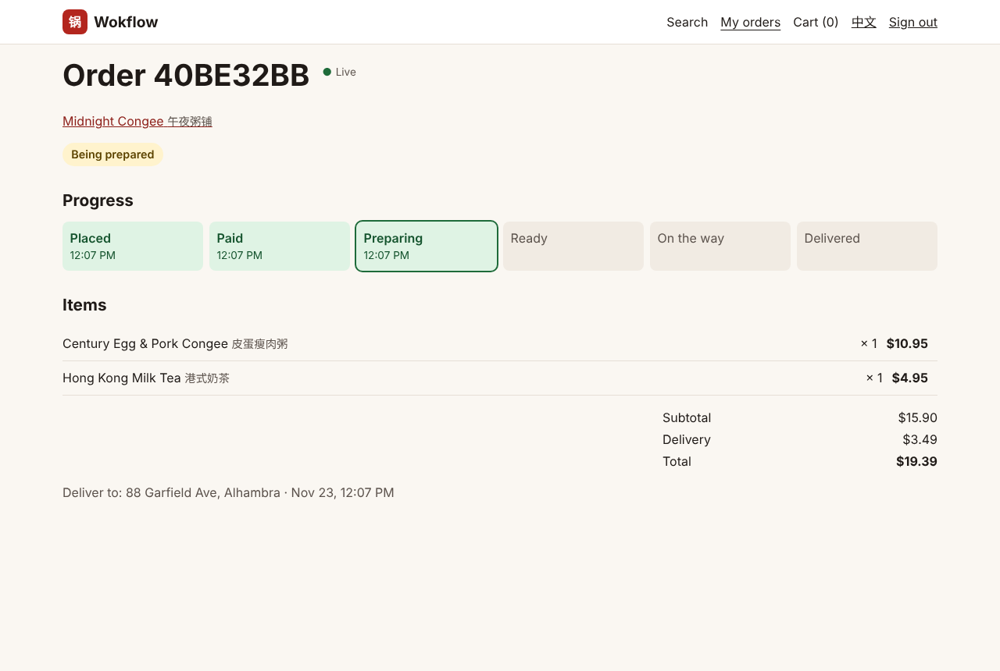
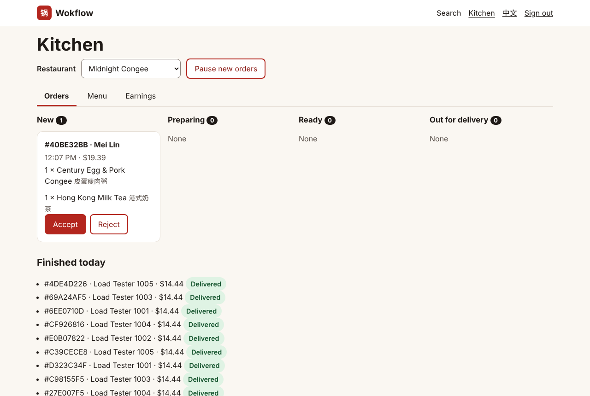
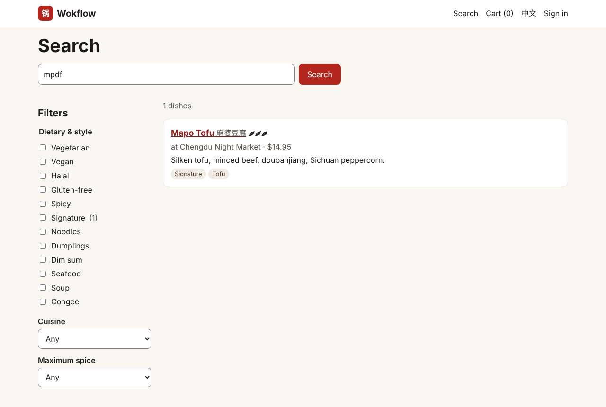
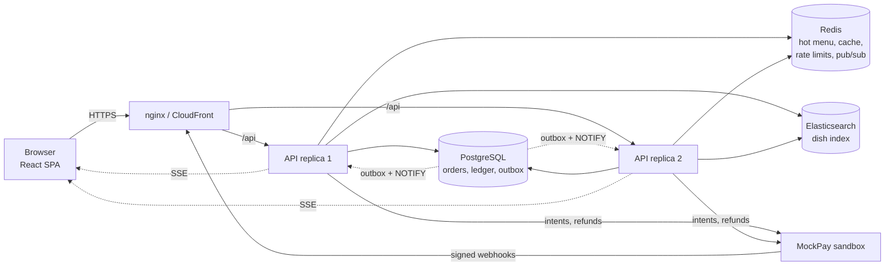

# Wokflow — Chinese food delivery platform

> **2026 rebuild.** I first built this project during a training program; that code was lost, so this
> repository is a from-scratch rebuild made in November 2026. Commit dates are real. Every performance
> number below was measured in this repository and is reproducible with the scripts in `loadtest/`
> (details and caveats in [docs/performance.md](docs/performance.md)).

Wokflow connects customers with regional Chinese restaurants (Sichuan, Cantonese, Lanzhou, Shanghai, Hunan,
Taiwanese…) in the San Gabriel Valley. Customers search in English, Chinese characters or pinyin, order and
pay, and watch the order move from wok to door live; kitchens run a live order board, manage their menu and
stock, and see their earnings in a double-entry ledger; riders claim and deliver jobs.

| Customer: live order tracking | Kitchen: live order board |
|---|---|
|  |  |
| **Search: `mpdf` → 麻婆豆腐 (pinyin initials)** | **中文界面 (mobile)** |
|  |  |

## What it does

- **Stateless JWT auth** for customers, merchants, riders and admins: short-lived ES256 access tokens are
  verified by signature alone (no database or session lookup; public keys at `/.well-known/jwks.json`).
  Refresh tokens are httpOnly, SameSite=Strict cookies, stored hashed and rotated on every use; re-using an
  old one revokes the whole family. Merchant tokens carry their restaurant scope.
- **Payment flow** against a bundled sandbox provider (`mockpay/`, shaped like a Stripe-style API): payment
  intents with idempotency keys, a hosted checkout page, HMAC-signed and timestamped webhooks delivered at
  least once with retries, refunds. Webhooks are processed exactly once; a payment that arrives after the
  order expired is booked and refunded automatically.
- **PostgreSQL ACID ledger**: double-entry, append-only (triggers refuse UPDATE/DELETE), every entry must sum
  to zero (deferred constraint trigger at commit), one entry per business event (`unique (kind, ref)`).
  Captures, refunds and merchant payouts; payouts cannot overdraw, even concurrently, and money held for
  pending refunds cannot be paid out.
- **Elasticsearch search**: English with typos (`dumplng`), Chinese characters (CJK bigrams + unigrams), and
  pinyin three ways (`mapo doufu`, `mapodoufu`, initials `mpdf`); tag, cuisine and spice filters with facet
  counts; popularity boost. Changes reach the index through the outbox with external versioning; the index is
  rebuilt with an alias swap when it is missing, out of step with Postgres, or its mapping changed. If
  Elasticsearch is down, search degrades to Postgres trigram matching instead of failing.
- **Redis ZSet hot menu**: per-restaurant hourly sorted sets of paid dish counts, summed over 24 h with
  `ZUNIONSTORE`. Counting is exactly-once per order (marker + increments in one Lua script) and the counters
  rebuild themselves from the ledger if Redis loses them. Redis also holds the menu cache (versioned keys,
  so a menu change can never be overwritten by a stale copy), sliding-window rate limits and the live-status
  pub/sub channel.
- **Peak-hour orders without deadlocks or stale status**: every order change is a single-row compare-and-set
  (`UPDATE … WHERE status = ANY(…) AND version = ?`); limited stock is reserved in single autocommit
  statements in ascending dish order (no lock convoy on a popular dish, no deadlock); placements go through a
  bulkhead and answer overload with `503 Retry-After`, which clients retry with the same Idempotency-Key.
  Status changes are published through a transactional outbox (LISTEN/NOTIFY wake-up) to Redis and pushed
  to browsers over SSE; every event carries the order version, so a client never moves backwards.
- **Web app** (React 19, TypeScript): customer, kitchen and rider views; English/中文 with a completeness test
  for the dictionary; WCAG 2.1 AA audited with axe in CI; strict CSP; rarely used pages are lazy-loaded.

## Measured (2-vCPU VM, everything incl. the load generator on one machine)

| What | Result |
|---|---|
| 600 orders placed at the same instant, each then paid, accepted, readied, claimed, picked up, delivered | all 600 handled in 3 consecutive warm runs: 400 delivered + 200 correctly refused as sold out (300 people wanted a dish with 100 baskets); **0 deadlocks, 0 oversold, 0 stale reads** in 2,000 read-after-write checks per run, ledger audit clean |
| Steady rush, 60 s | 15 orders/s: place p50 12 ms / p95 29 ms; 40 orders/s: p50 23 ms / p95 816 ms; 60 orders/s: overloaded (p50 1.9 s) but still 0 errors |
| Payment confirmed → order PAID (server clocks) | p50 29–32 ms at steady load; 0.3–0.5 s during the 600-order burst |
| Live status over SSE (commit → browser) | 5 streams: p50 13–23 ms; 200 streams under load: p50 227 ms, p95 538 ms; 0 version regressions |
| Hot menu, 293,583 paid orders in the window | Redis 0.35 ms (0.06 ms cached) vs SQL aggregation 246 ms; identical top 6 |
| Search, 100,000 dishes, 20 clients | Elasticsearch p50 113–168 ms vs Postgres fallback 2.8 s; top-1 accuracy on 16 typo/pinyin/Chinese queries 15/16 vs 10/16 |
| Lighthouse (mobile) | 100/100/100/100 on home, search, sign-in, cart; 93/100/100/100 on restaurant pages |

At 64 demo dishes the Postgres fallback is actually faster than Elasticsearch (30 ms vs ~100 ms); the
point of Elasticsearch here is relevance and facets at catalog scale. Conversion impact (the original
resume line claimed "+18%") cannot be measured without real users and is not claimed.

## Architecture



| Module | |
|---|---|
| `api/` | Spring Boot 4.2 (Java 21, virtual threads), JDBC + Flyway, Spring Security resource server, Elasticsearch Java client 9, Lettuce |
| `mockpay/` | Sandbox payment provider: intents, hosted checkout, refunds, webhook delivery with leases and backoff |
| `web/` | React 19 + React Router 8 + Vite 8, TypeScript, Vitest, Playwright + axe |
| `loadtest/` | k6 peak-hour test, database invariant checks, SSE latency check, search and hot-menu benchmarks |
| `infra/` | Terraform for AWS (CloudFront, ECS Fargate, RDS, ElastiCache, WAF) + Elastic Cloud — validated and scanned, not applied ([infra/README.md](infra/README.md)) |

Key flows are described in [docs/engineering-notes.md](docs/engineering-notes.md), together with the bugs
found while building and measuring it.

## Run it

Requirements: Docker with Compose v2.

```bash
docker compose up -d --build --wait     # first build takes a few minutes
open http://localhost:8000
```

Demo accounts (password `wokflow-demo`): `customer@example.com`, `merchant@example.com` (Lucky Star
Dumplings, Midnight Congee, Chengdu Night Market), `partners@example.com` (the other kitchens),
`rider@example.com`, `rider2@example.com`, `admin@example.com`. Midnight Congee and Lucky Star Dumplings are
open 24 hours, so there is always somewhere to order from; the others keep real hours in their own time zone.
Payment happens on the MockPay page (http://localhost:8090): **Pay** or **Decline** — no card details.

Data lives in Docker volumes and survives `docker compose restart` / `down`; `docker compose down -v` resets.

### Development mode

```bash
docker run -d --name wf-pg -p 5432:5432 -e POSTGRES_USER=wokflow -e POSTGRES_PASSWORD=wokflow -e POSTGRES_DB=wokflow postgres:18.7-alpine
docker exec wf-pg sh -c 'until pg_isready -U wokflow; do sleep 1; done; psql -U wokflow -c "create database mockpay"'
docker run -d --name wf-redis -p 6379:6379 redis:8.8.4-alpine
docker run -d --name wf-es -p 9200:9200 -e discovery.type=single-node -e xpack.security.enabled=false \
  -e cluster.routing.allocation.disk.threshold_enabled=false -e ES_JAVA_OPTS="-Xms512m -Xmx512m" elasticsearch:9.5.5

mvn -q -DskipTests package
JWT_PRIVATE_KEY_FILE=secrets/jwt.pem JWT_GENERATE_IF_MISSING=true java -jar api/target/wokflow-api.jar   # :8080
java -jar mockpay/target/wokflow-mockpay.jar                                                              # :8090
cd web && npm ci && npm run dev                                                                            # :5173
```

API docs: http://localhost:8080/api/docs (OpenAPI at `/api/openapi.json`).

## Tests

```bash
mvn verify                       # 77 backend tests (81 runs) on real Postgres, Redis and Elasticsearch (Testcontainers); JaCoCo report
cd web && npm run lint && npm run typecheck && npm test
cd web && E2E_BASE_URL=http://localhost:8000 npx playwright test     # against the compose stack
```

- Backend (API line coverage 88.8%, branch 73.3%): auth (tampering, `alg: none`, expiry, refresh reuse),
  the order lifecycle and every refusal, webhooks (signature, replay window, duplicates), refunds with a
  provider outage, payment expiry and late payments, concurrency (200 customers racing for 50 baskets,
  accept vs cancel, rider claims, webhook storms, concurrent payouts, concurrent retries of one order),
  ledger constraints, a deadlock negative control (so "0 deadlocks" means something), search relevance and
  self-healing, hot-menu counting and rebuild, SSE, outbox retries, rate limits, opening hours across DST,
  the daily restock and the clean-up jobs (the things that only break days later).
- End to end (Playwright, Chromium + mobile, Firefox, WebKit, all in CI against the Docker stack): a
  customer, a kitchen and a rider in separate browsers moving one order to the door while the customer
  watches it update; declined payment; a stale kitchen screen; search in three scripts; the Chinese UI;
  axe WCAG 2.1 AA audits on every page.
- CI also restarts every container and checks that orders, the hot menu and the search index come back,
  builds the images for amd64 and arm64, and runs `terraform validate`, tflint and Checkov.

## Load tests

```bash
SEED_LOADTEST_USERS=1200 RATE_LIMIT_ENABLED=false docker compose up -d --wait
./loadtest/prepare.sh
docker run --rm --network host -v "$PWD/loadtest:/lt" grafana/k6:2.4.0 run -e VUS=600 /lt/peak.js   # everyone at once
docker run --rm --network host -v "$PWD/loadtest:/lt" grafana/k6:2.4.0 run -e VUS=1000 -e RATE=15 /lt/peak.js
./loadtest/verify.sh             # deadlocks, oversell, ledger, history/status agreement, payment latency
node loadtest/live-watch.mjs 200 # SSE latency and ordering
```

## License

MIT
