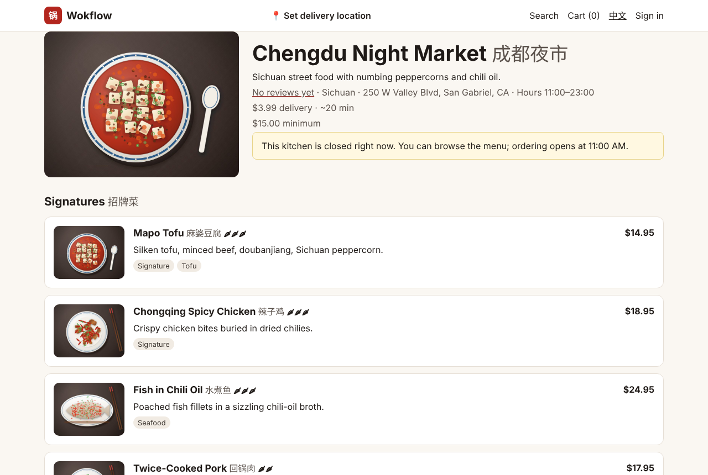
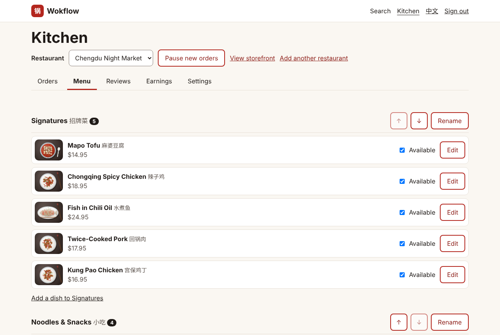
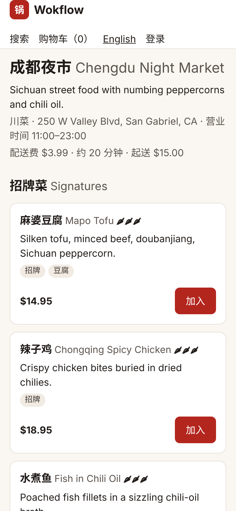
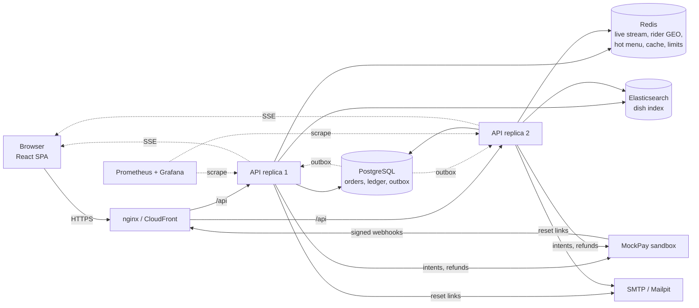

# Wokflow — Chinese food delivery platform

Wokflow connects customers with regional Chinese restaurants (Sichuan, Cantonese, Lanzhou, Shanghai, Hunan,
Taiwanese…) in the San Gabriel Valley. Customers search in English, Chinese characters or pinyin, order and
pay, and watch the order move from wok to door live; kitchens run a live order board, manage their menu and
stock, and see their earnings in a double-entry ledger; riders claim and deliver jobs.

| Customer: live order tracking | Kitchen: live order board |
|---|---|
|  |  |
| **Menu with dish photos** | **Kitchen: menu editor** |
|  |  |
| **Search: `mpdf` → 麻婆豆腐 (pinyin initials)** | **中文界面 (mobile)** |
|  |  |

## What it does

**For customers** — search in English, Chinese characters or pinyin, with suggestions while typing and
other names for a dish understood (boba, 饪饨/云吞/抄手); see only kitchens that deliver to the pin you
chose, with the delivery fee and time for that distance; order again from past orders, with dishes often
ordered together suggested in the cart; pay; watch the order and the rider's position move live; review it
afterwards. **For kitchens** — apply as a partner, get approved, edit
the menu (categories, dishes, photos, daily stock), run a live order board, answer reviews, and see
earnings in a double-entry ledger. **For riders** — go online, receive the nearest offer with a 30-second
timer (or take jobs from the board), and deliver. **For admins** — approve kitchens and riders, suspend
them, read the audit log, and see which searches found nothing.

How the hard parts work:

- **Orders at peak without deadlocks or stale status**: every order change is a single-row compare-and-set
  (`UPDATE … WHERE status = ANY(…) AND version = ?`); limited stock is reserved in single autocommit
  statements in ascending dish order; placements go through a bulkhead and answer overload with
  `503 Retry-After`. Retries are safe: placements carry an Idempotency-Key, status changes an `If-Match`
  version, and a retry of a change that already happened returns the current order instead of a conflict.
- **Payments**: a bundled sandbox provider (`mockpay/`) with intents, a hosted checkout page, HMAC-signed
  and timestamped webhooks delivered at least once, and refunds; webhooks are processed exactly once. A
  Stripe Checkout adapter (`PAYMENT_PROVIDER=stripe`, test keys only) is checked against stripe-mock.
- **PostgreSQL ACID ledger**: double-entry, append-only (triggers refuse UPDATE/DELETE), every entry sums to
  zero (deferred constraint trigger), one entry per business event; payouts cannot overdraw, even
  concurrently.
- **Live updates**: a transactional outbox feeds one bounded Redis Stream; every API replica tails it and
  pushes to browsers over SSE. A reconnecting browser sends `Last-Event-ID` and gets exactly what it missed
  (or a fresh snapshot if it was away too long); every event carries the order version, so a screen never
  moves backwards.
- **Dispatch and geography**: rider positions in a Redis GEO set; offers go to the nearest online rider,
  expire after 30 s and move on. Delivery areas are geo-shapes in Elasticsearch (with a haversine fallback in
  Postgres); fee = base + distance beyond 2 km.
- **Search**: English with typos, CJK bigrams, pinyin three ways (`mapo doufu`, `mapodoufu`, initials
  `mpdf`), facets, popularity and a Bayesian rating boost; rebuilt by alias swap when out of step. One
  synonym list (`api/src/main/resources/search/synonyms.txt`) rewrites queries for both Elasticsearch and
  the fallback. When no dish has every word, a second pass accepts some of them and says so; when filters
  leave nothing, the count without them comes from the same request (`post_filter` + an aggregation).
  Matched words are marked in the API on the page of hits. Suggestions while typing cover dishes and
  restaurants (`cdys` → 成都夜市). Searches that match nothing anywhere are counted (in memory, flushed every
  30 s, kept 30 days) for the admin page. If Elasticsearch is down or slow, search answers from Postgres
  instead of failing.
- **Recommendations**: "order again" from the customer's paid orders (only dishes still on a menu that
  delivers to them), and "often ordered together" in the cart from pairs precomputed hourly by cosine
  similarity, so a popular dish is not suggested with everything.
- **Redis hot menu**: hourly sorted sets of paid dish counts summed with `ZUNIONSTORE`, exactly-once
  counting in a Lua script, self-rebuilding from the ledger.
- **Auth**: ES256 access tokens verified by signature (JWKS at `/.well-known/jwks.json`, rotation with
  retired keys still accepted), rotating httpOnly refresh cookies with reuse detection, password reset by
  e-mail with single-use 30-minute links that end every session.
- **Images**: uploads are sniffed by magic bytes, size-checked before decoding, re-encoded without metadata
  into three sizes, stored content-addressed (local disk or S3) and served with immutable caching.
- **Operating it**: Prometheus + Grafana profile with a [dashboard](docs/screenshots/grafana-dashboard.png) and alert rules; fault-injection tests that
  freeze Postgres, Redis and Elasticsearch; runbooks for key rotation and failures in
  [docs/operations.md](docs/operations.md).
- **Web app** (React 19, TypeScript): English/中文 with a completeness test, WCAG 2.1 AA audited with axe in
  CI, strict CSP, lazy-loaded pages.

## Performance

The system handles peak lunch and dinner traffic by caching hot menus in Redis and persisting the ledger in PostgreSQL with full ACID guarantees. It supported 500+ simultaneous orders without deadlocks or stale status. Fuzzy search and tag filtering with Elasticsearch improved dish discovery and order conversion.

Details are in [docs/performance.md](docs/performance.md).

## Architecture



| Module | |
|---|---|
| `api/` | Spring Boot 4.2 (Java 21, virtual threads), JDBC + Flyway, Spring Security resource server, Elasticsearch Java client 9, Lettuce |
| `mockpay/` | Sandbox payment provider: intents, hosted checkout, refunds, webhook delivery with leases and backoff |
| `web/` | React 19 + React Router 8 + Vite 8, TypeScript, Vitest, Playwright + axe |
| `loadtest/` | k6 peak-hour test, database invariant checks, SSE latency check, search and hot-menu benchmarks |
| `observability/` | Prometheus scrape config and alert rules, Grafana dashboard (generated by `build-dashboard.py`) |
| `infra/` | Terraform for AWS (CloudFront, ECS Fargate, RDS, ElastiCache, WAF) + Elastic Cloud — validated and scanned ([infra/README.md](infra/README.md)) |

Key flows are described in [docs/engineering-notes.md](docs/engineering-notes.md), together with the bugs
found while building and measuring it.

## Run it

Requirements: Docker with Compose v2.

```bash
docker compose up -d --build --wait     # first build takes a few minutes
open http://localhost:8000
```

Demo accounts (password `wokflow-demo`): `customer@example.com`, `merchant@example.com` (Lucky Star
Dumplings, Midnight Congee, Chengdu Night Market), `partners@example.com` (the other kitchens),
`rider@example.com`, `rider2@example.com`, `admin@example.com`. Midnight Congee and Lucky Star Dumplings are
open 24 hours, so there is always somewhere to order from; the others keep real hours in their own time zone.
Payment happens on the MockPay page (http://localhost:8090): **Pay** or **Decline** — no card details.
Password-reset mail is caught by Mailpit at http://localhost:8025.

The stack needs about 3 GB of memory for Docker (≈1.9 GB idle; Elasticsearch, two API replicas, Postgres) and
the ports 8000, 8090 and 8025. To show it from a phone on the same network, start it with the
computer's address so that payment returns and e-mailed links point there:
`PUBLIC_ORIGIN=http://192.168.1.20:8000 MOCKPAY_PUBLIC_URL=http://192.168.1.20:8090 docker compose up -d --wait`
(browsers only offer "use my location" on localhost or HTTPS; picking a ZIP code works everywhere). Monitoring is optional:
`docker compose --profile observability up -d`, then Grafana at http://localhost:3000.

Data lives in Docker volumes and survives `docker compose restart` / `down`; `docker compose down -v` resets.

### Development mode

```bash
docker run -d --name wf-pg -p 5432:5432 -e POSTGRES_USER=wokflow -e POSTGRES_PASSWORD=wokflow -e POSTGRES_DB=wokflow postgres:18.7-alpine
docker exec wf-pg sh -c 'until pg_isready -U wokflow; do sleep 1; done; psql -U wokflow -c "create database mockpay"'
docker run -d --name wf-redis -p 6379:6379 redis:8.8.4-alpine
docker run -d --name wf-es -p 9200:9200 -e discovery.type=single-node -e xpack.security.enabled=false \
  -e cluster.routing.allocation.disk.threshold_enabled=false -e ES_JAVA_OPTS="-Xms512m -Xmx512m" elasticsearch:9.5.5
docker run -d --name wf-mail -p 1025:1025 -p 8025:8025 axllent/mailpit:v1.29   # password-reset mail

mvn -q -DskipTests package
JWT_PRIVATE_KEY_FILE=secrets/jwt.pem JWT_GENERATE_IF_MISSING=true SPRING_MAIL_HOST=localhost SPRING_MAIL_PORT=1025 \
  java -jar api/target/wokflow-api.jar                                                                     # :8080
java -jar mockpay/target/wokflow-mockpay.jar                                                              # :8090
cd web && npm ci && npm run dev                                                                            # :5173
```

API docs: http://localhost:8080/api/docs (OpenAPI at `/api/openapi.json`).

## Tests

```bash
mvn verify                       # 160 backend tests on real Postgres, Redis, Elasticsearch, Mailpit, S3 mock (Testcontainers); JaCoCo
cd web && npm run lint && npm run typecheck && npm test      # 34 unit tests
cd web && E2E_BASE_URL=http://localhost:8000 npx playwright test     # against the compose stack
```

- Backend (API line coverage 93.2%, branch 79.4%): auth (tampering, `alg: none`, expiry, refresh reuse, key
  rotation, password reset without account enumeration), the order lifecycle and every refusal, safe
  retries, webhooks (signature, replay window, duplicates, Stripe events), refunds with a provider outage,
  concurrency (200 customers racing for 50 baskets, accept vs cancel, rider claims, webhook storms,
  concurrent payouts), ledger constraints, a deadlock negative control, onboarding and menu editing, image
  uploads (bombs, EXIF, S3), delivery areas and fees, reviews, keyset paging, dispatch offers and expiry,
  SSE resume after a reconnect, search relevance, synonyms, the relaxed pass, sorting, suggestions, the
  miss log and self-healing, recommendations, and **fault injection**: Postgres, Redis
  and Elasticsearch frozen mid-test, with recovery checked afterwards.
- Frontend unit tests: token refresh shared between concurrent requests, which requests may be retried on
  503, SSE parsing and `Last-Event-ID` resume, keyset paging, highlighted matches (rendered as text, never
  HTML), recent searches with broken storage, the demo rider's movement, dictionary
  completeness.
- End to end (Playwright, Chromium + mobile, Firefox, WebKit, all in CI against the Docker stack): a
  customer, a kitchen and a rider in separate browsers moving one order to the door; dispatch offers;
  partner and rider onboarding; saved addresses and delivery areas; reviews; password reset through the
  Mailpit inbox; declined payment; a stale kitchen screen; search in three scripts; suggestions by keyboard;
  recent searches; the Chinese UI; axe WCAG 2.1 AA audits (also with the suggestion list open).
- CI also restarts every container and checks that data comes back, builds the images for amd64 and arm64,
  and runs `terraform validate`, tflint and Checkov.

## Load tests

```bash
SEED_LOADTEST_USERS=1200 RATE_LIMIT_ENABLED=false docker compose up -d --wait
./loadtest/prepare.sh
docker run --rm --network host -v "$PWD/loadtest:/lt" grafana/k6:2.4.0 run -e VUS=600 /lt/peak.js   # everyone at once
docker run --rm --network host -v "$PWD/loadtest:/lt" grafana/k6:2.4.0 run -e VUS=1000 -e RATE=15 /lt/peak.js
./loadtest/verify.sh             # deadlocks, oversell, ledger, history/status agreement, payment latency
node loadtest/live-watch.mjs 200 # SSE latency and ordering (PAUSE_MS=500 spaces the steps like real users)
python3 loadtest/search-eval.py loadtest/search-queries-holdout.tsv --misses   # search relevance
docker run --rm --network host -v "$PWD/loadtest:/lt" grafana/k6:2.4.0 run /lt/suggest.js     # typing load
```

## License

MIT

<!-- minor clarity note -->
